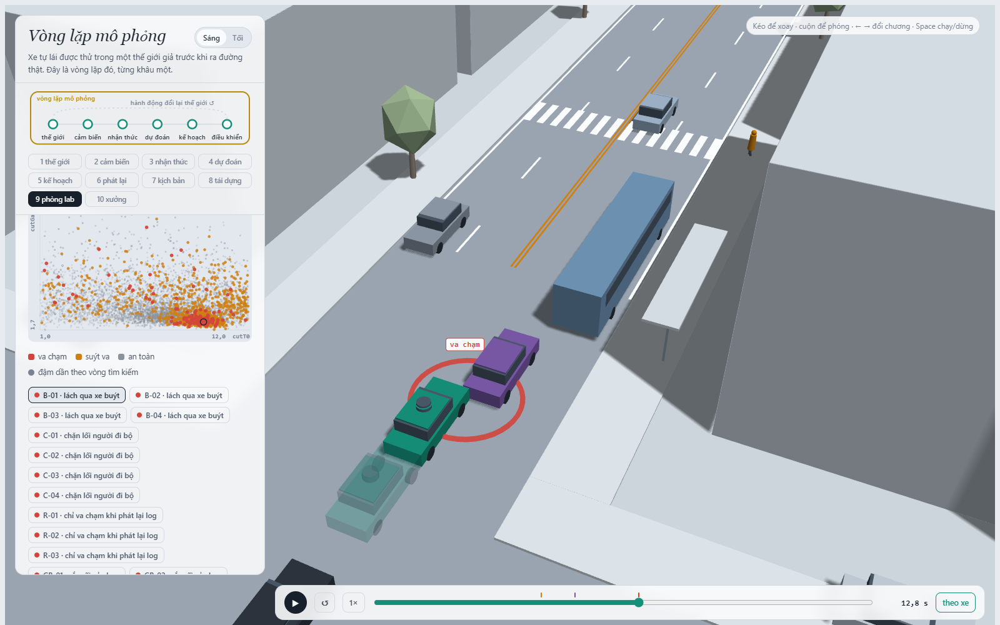
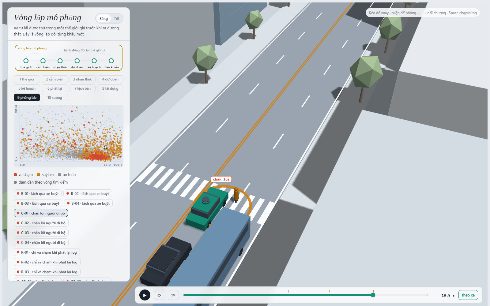
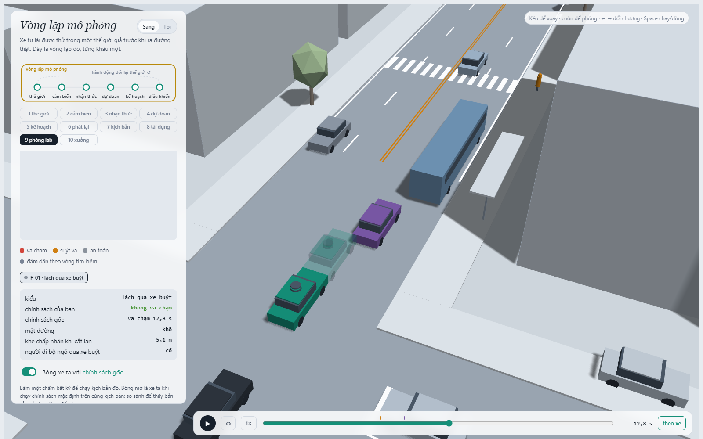
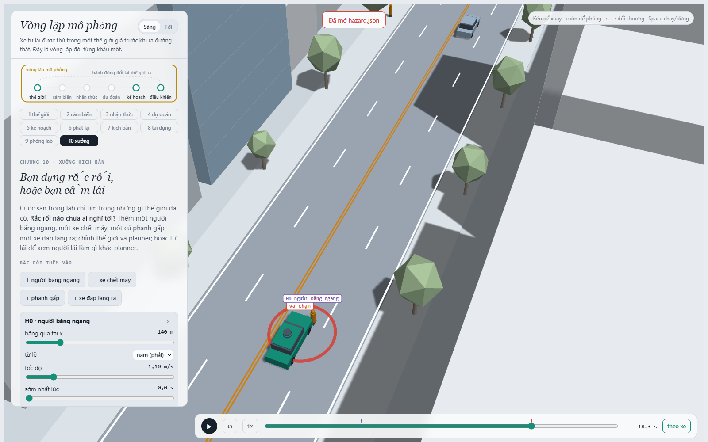

MSSV: 202602818

# Lab 11 · Scenario Forge — báo cáo

Thị trấn: **A** (`meta.json: _run.town`). Các bước dùng ngân sách đầy đủ, không `--quick`. Giá trị trong bảng làm tròn để đọc; JSON giữ đủ độ chính xác. Các kiểm tra bổ sung được ghi riêng, không thay kết quả pipeline hoặc dùng để chọn lại policy trên TEST.

## 1. Phát lại log có trung thực không?

`replay.json: n = 400`, `dropped_human_crash_logs = 1`, `n_used = 399`. Loại log có thất bại của người lái gốc để so sánh trên log không có tai nạn của ego.

| Chế độ | Tổng thất bại | front | rear | side |
|---|---:|---:|---:|---:|
| replay | 110 | 0 | 103 | 7 |
| reactive | 0 | 0 | 0 | 0 |

Nguồn: `replay.json: replay`, `reactive`; nhãn tiếp xúc không có trong dictionary nghĩa là không ghi nhận sự kiện loại đó. `crash_in_both = 0`. Không ghi nhận thất bại không chứng minh xác suất thật bằng 0.

Planner giảm tốc sớm hơn người lái gốc; xe sau trong replay vẫn theo quỹ đạo được ghi khi nó đi sau người lái gốc. Nó không phản ứng với hành vi mới của ego nên có thể tông vào ego. Tiếp xúc phía sau chiếm 93.6363636% thất bại replay. Trong thế giới phản ứng, xe sau được điều chỉnh theo ego hiện tại. Chênh lệch cho thấy replay có thể tạo va chạm giả, không phải bằng chứng planner thật sự gây từng tai nạn đó.

Ví dụ `replay_only[0].scenario = 0`, `contact = "rear"`: xe TG đi theo log và tông phía sau ego; cùng tham số reactive không có thất bại. `replay_only[0].min_ttc_reactive = 7.52684683` giây. TTC này đo ego tiến gần tác nhân nó đang theo, không phải TTC của xe TG tông vào ego. Log ở lab là log người lái mô phỏng, không phải ghi hình xe thực tế.

## 2. Kịch bản bất khả thi

`lab11/feasible.py: is_feasible` áp dụng các luật sau:

| Luật | Căn cứ |
|---|---|
| `(pi/cutDur)^2 * 3.5/2 <= mu*9.81` | Độ bám phải đủ cho gia tốc ngang cực đại của chuyển làn cosine 3,5 m. |
| `cutBrake <= mu*9.81` | Phanh sau chuyển làn không vượt độ bám trong mô hình. |
| `pedV <= 2.5 m/s` | Giữ trong miền tốc độ người đi bộ lab xét; không phải giới hạn tốc độ tối đa của con người. |
| `0 < cutV <= 22 m/s` | Giữ trong dải xe chuyển làn mà lab cho phép. |

Hàm cũng loại thời gian chuyển làn không dương. Với 1,6 s, gia tốc ngang cần khoảng 6,75 m/s²: hợp lệ ở mu=0,8 nhưng vượt giới hạn 4,905 m/s² ở mu=0,5.

| Cuộc săn | Mẫu bị loại (`hunt.json: <kiểu>.infeasible`) |
|---|---:|
| bus_bypass | 1 |
| cut_in | 6 |
| crosswalk_block | 9 |
| rear_ended | 20 |

Cuộc săn `rear_ended` sinh nhiều mẫu bất khả thi nhất: 20/2400. Tổng bị loại là 36/9600. Kiểm tra bổ sung từng dòng `cloud.json` có `out = "infeasible"` cho thấy tất cả vi phạm gia tốc ngang vượt độ bám. CEM có thể bị kéo về chuyển làn gấp vì chúng tạo tương tác nguy hiểm. Bộ lọc loại chúng trước khi chạy planner và trước cập nhật elite; đếm chúng là thất bại sẽ làm tăng giả tạo nguy cơ và đánh giá trên miền không hợp lệ.

## 3. Monte Carlo cho biết gì?

| Chỉ số (`mc.json`) | Giá trị |
|---|---:|
| `n` | 3000 |
| `crashes` | 4 |
| `p` | 0.00133333333 |
| `lo` | 0.000518617263 |
| `hi` | 0.00342353468 |
| `infeasible` | 19 |

Ước lượng thất bại là 0.133333333%, Wilson 95% [0.0518617263%, 0.342353468%]. Theo pipeline lab, mẫu bị loại không được chạy và không được tính là thất bại; mẫu số vẫn là số mẫu tự nhiên đã rút, không chuẩn hóa lại theo số mẫu hợp lệ.

Để đạt sai số tương đối khoảng ±20% ở mức 95%, n ≈ 1,96²(1-p)/(0,2²p) ≈ 96/p. Thay `mc.json: p` cho ngân sách xấp xỉ **72000 mẫu**, gấp 24 lần hiện tại. Đây là kế hoạch xấp xỉ từ ít thất bại, không bảo đảm lần chạy sau đạt độ chính xác đó.

| Kiểu | k | Wilson 95% (`mc.json: per_mode.<kiểu>`) |
|---|---:|---|
| bus_bypass | 4 | [0.000518617263, 0.00342353468] |
| cut_in | 0 | [0, 0.00127889566] |
| crosswalk_block | 0 | [0, 0.00127889566] |
| rear_ended | 0 | [0, 0.00127889566] |
| other | 0 | [0, 0.00127889566] |

Các kiểu có k=0 chỉ được báo là chưa quan sát, kèm cận trên Wilson; không kết luận xác suất thật bằng 0. Khoảng chuẩn có thể suy biến thành [0,0] ở k=0, nên dùng Wilson.

## 4. Importance sampling, ESS và độ suy biến

Hỗn hợp phòng thủ q=0,8·CEM+0,2·p, trọng số w=p/q. Ước lượng là mean(w·y), không chia lại cho tổng w. Nguồn từng hàng: `estimate.json: seeds[seed].per.<kiểu>`; mỗi hàng có n=600.

| Seed | Kiểu | p hoặc cận khi không hit | hits | ess | top_share |
|---:|---|---:|---:|---:|---:|
| 0 | bus_bypass | 0.00183049535 | 39 | 127.069833 | 0.490844225 |
| 0 | cut_in | ≤ 0.025 (cận 95%) | 0 | 133.177849 | 0 |
| 0 | crosswalk_block | 2.43751963e-07 | 51 | 117.035134 | 0.378943765 |
| 0 | rear_ended | ≤ 0.025 (cận 95%) | 0 | 119.196343 | 0 |
| 1 | bus_bypass | 0.000456150974 | 31 | 131.158115 | 0.329195099 |
| 1 | cut_in | ≤ 0.025 (cận 95%) | 0 | 124.786584 | 0 |
| 1 | crosswalk_block | 3.75865596e-07 | 65 | 122.185395 | 0.501288368 |
| 1 | rear_ended | ≤ 0.025 (cận 95%) | 0 | 116.384345 | 0 |
| 2 | bus_bypass | 0.000542112413 | 41 | 119.223775 | 0.220967904 |
| 2 | cut_in | ≤ 0.025 (cận 95%) | 0 | 121.859909 | 0 |
| 2 | crosswalk_block | 2.46369346e-07 | 52 | 107.812497 | 0.331111263 |
| 2 | rear_ended | ≤ 0.025 (cận 95%) | 0 | 122.128914 | 0 |

| Seed | total | Khoảng xấp xỉ lưu trong JSON | Sai số tương đối 1,96·se/total (các mode có hit) | n MC tương đương sai số chuẩn |
|---:|---:|---|---:|---:|
| 0 | 0.0018307391 | [0, 0.0050332373] | 105.072456% | 1383 |
| 1 | 0.00045652684 | [8.42007242e-05, 0.00210774862] | 81.5562379% | 36900 |
| 2 | 0.000542358782 | [0.000217883658, 0.00214572957] | 59.8266563% | 48586 |

Tổng giữa các seed chênh 4.0101456 lần; trung vị 0.000542358782 thấp hơn MC 2.45839724 lần. Hai tổng seed 0 và 2 nằm trong khoảng Wilson MC; seed 1 thấp hơn cận dưới MC, nhưng khoảng IS lưu của seed đó vẫn giao khoảng MC. Đây là sự tương thích của các khoảng rộng, không phải xác nhận độ chính xác IS. `crosswalk_block` rất nhỏ trong IS dù cuộc săn tìm được nhiều ví dụ: điểm nguy hiểm có thể đưa đề xuất vào một cơ chế cực hiếm và bỏ sót cơ chế khác.

Cột n MC tương đương tính bằng ceil(p_MC·(1-p_MC)/se_IS²), với se_IS là căn tổng bình phương sai số chuẩn của các mode trong seed tương ứng. Nó chỉ so sai số chuẩn xấp xỉ, chưa tính cận zero-hit và sai lệch do bỏ sót vùng thất bại; không xem đây là chứng nhận cùng độ chính xác thật.

`top_share` là tỷ lệ ước lượng do mẫu đóng góp lớn nhất mang lại; seed 1, crosswalk_block có top_share=0.501288368 >0,5, nên hơn nửa con số đến từ một mẫu. ESS thấp cho biết trọng số lệch; ESS hoặc top_share tốt cũng không chứng minh q đã phủ hết miền va chạm. Khoảng ±1,96·se của IS là xấp xỉ và có thể quá hẹp khi chỉ vài mẫu nặng ký quyết định.

`estimate.json: budget = 16800` gồm 9600 mẫu săn và 7200 mẫu IS; phần `other` dùng lại 3000 mẫu MC, nên tổng ngân sách có MC là 19800. MC để hướng tới ±20% cần khoảng 72000 mẫu, lớn hơn ngân sách IS ghi trong JSON 4.28571429 lần. Tuy nhiên độ chính xác IS quan sát được chưa đạt ±20%, nên không tuyên bố ngân sách này đạt cùng độ chính xác.

`estimate.json: other.source = "mc.json"`, `other.k = 0`, `other.n = 3000`, `other.hi = 0.00127889566`. other là phần va chạm còn lại để tổng không bỏ sót; lấy từ MC vì không có cuộc săn hay điểm nguy hiểm riêng cho nhóm không đồng nhất này. Không hit ở cut_in/rear_ended phải dùng `upper_zero_hits = 3/(0.2*600) = 0.025`, không dùng 3/ESS hoặc coi các trường p=0, hi=0 của ước lượng thô là chứng nhận không có nguy cơ. Các khoảng total trong file cũng không thay thế các cận zero-hit theo mode này.

## 5. Các kiểu thất bại

Nguồn: `hunt.json: <mục tiêu>.found`, `<mục tiêu>.infeasible`. Bốn cuộc săn dùng 8 vòng × 300 mẫu/kiểu; `cloud.json` có 9600 dòng. Số lần tìm được trong các mẫu thích nghi không phải xác suất tự nhiên.

| Mục tiêu | found | Mẫu bất khả thi |
|---|---|---:|
| bus_bypass | `{"bus_bypass": 129, "crosswalk_block": 1}` | 1 |
| cut_in | `{"bus_bypass": 20}` | 6 |
| crosswalk_block | `{"crosswalk_block": 37}` | 9 |
| rear_ended | `{"crosswalk_block": 14}` | 20 |

**B-01**, tại 12.75 s: Xe C2 chờ khe để lách xe buýt, lấn vào làn ego khi đang chậm; ego không phanh kịp trước tiếp xúc. Nguồn thời điểm: `visual_checks.json: runs` (kiểm tra bổ sung bằng JS trên đúng tham số `viewer.json`).

**C-01**, tại 18.75 s: P1 không ngó qua xe buýt, bước qua đường; ego phanh trên đường ướt nhưng dừng chắn lối người đi bộ. Sự kiện block là thất bại dù không có contact. Nguồn thời điểm: `visual_checks.json: runs` (kiểm tra bổ sung bằng JS trên đúng tham số `viewer.json`).

Không tìm thấy cut_in hoặc rear_ended, nhưng không thể kết luận chúng không tồn tại. Cuộc săn cut_in lại gặp bus_bypass, còn rear_ended gặp crosswalk_block. Săn riêng crosswalk_block tìm 37 trường hợp, trong khi săn bus_bypass chỉ tình cờ gặp 1: một cuộc săn chung dễ hội tụ vào một cơ chế và bỏ sót cơ chế khác. Nhiều cuộc săn riêng cải thiện độ bao phủ nhưng vẫn hữu hạn.

## 6. Sửa planner

Policy chọn từ TRAIN: `{"cutinLat": 3.0}` (`fix.json: chosen.policy`). Các núm không nêu giữ mặc định. Chọn fail_hi nhỏ nhất trong các ứng viên giữ ít nhất 95% quãng đường baseline; nếu bằng điểm ưu tiên quãng đường cao hơn. Không sửa danh sách ứng viên sau khi xem TEST.

Tăng cutinLat từ mặc định 2,15 lên 3,0 m khiến ego coi xe đang lấn làn là tác nhân phía trước sớm hơn, nhờ đó có thêm thời gian giảm tốc trước khi xe đó vào sát làn ego. Đây là thay đổi policy, không phải thay quy luật giao thông hoặc loại bỏ kịch bản khó.

| Tập / policy | fail | fail_hi_seen | fail_hi | Quãng đường m | Khung phanh gấp trung bình |
|---|---:|---:|---:|---:|---:|
| baseline_train | 0.000764574733 | 0.00139969297 | 0.00139969297 | 212.987469 | 8.58203125 |
| chosen (TRAIN) | 2.53234891e-06 | 6.9596508e-06 | 6.9596508e-06 | 212.975995 | 8.18359375 |
| baseline_test | 0.0010300416 | 0.00181396253 | 0.00309285819 | 214.523828 | 8.35666667 |
| chosen_test | 5.97610197e-07 | 9.75803272e-07 | 0.0387798715 | 214.333162 | 7.99366667 |

Nguồn: `fix.json: baseline_train`, `chosen`, `baseline_test`, `chosen_test`. `harsh` đếm số khung có a<-3 m/s² trung bình mỗi kịch bản, không phải số đợt đạp phanh độc lập. Quãng đường pipeline được chặn tại thất bại đầu tiên. Mất quãng đường TRAIN của bản chọn so baseline là 0.00538734556%; TEST là 0.0888790344%.

TRAIN dùng cùng các mẫu cho mọi ứng viên và đề xuất săn dưới policy gốc. TEST dùng seed mới, mẫu tự nhiên mới và săn mới nhắm riêng từng policy; không chọn lại theo TEST. `chosen.unseen = ['bus_bypass']`, `chosen_test.unseen = ['bus_bypass']`. Giá trị fail=0 nếu có chỉ là ước lượng quan sát, không chứng minh an toàn tuyệt đối.

Một kiểu chưa có hit trên TEST vẫn đóng góp 3/(0,2·400)=0,0375 vào fail_hi; tập tự nhiên riêng còn đóng góp Wilson cho các va chạm ngoài hai kiểu được săn. Vì vậy fail_hi của bản sửa có thể lớn hơn fail của policy gốc dù dữ liệu có hit cho thấy cải thiện. fail_hi_seen chỉ cộng phần có hit, không phải chứng nhận toàn policy. Các cận trong lab và khoảng IS vẫn phụ thuộc giả định lấy mẫu/xấp xỉ đã nêu ở câu 4.

Ảnh dùng `fix_comparison_viewer.json`: xe đặc là policy chọn, bóng mờ là policy gốc, cùng tham số từ B-01. Tại 12.75 s policy gốc thất bại, policy chọn không có sự kiện ego trong 24 s (`visual_checks.json: fix_comparison.baseline_events`, `chosen_events`). Đây là minh họa, không thay TEST.

**Núm có thể phản tác dụng — kiểm tra bổ sung ngoài pipeline:** `safer_knob_case.json` lưu tham số dòng `cloud.json[1238]`, policy `cautionV=5.0`, `baseline_events=[]`, và `changed_events[0]` là tiếp xúc ego–C2 ở 13,9 s. Giảm tốc thận trọng nghe an toàn hơn nhưng làm đổi thời điểm ego gặp xe chuyển làn và khe xe đó chấp nhận; thế giới phản ứng lại nên một cảnh an toàn có thể thành va chạm. Đây là phản ví dụ trên một cảnh, không kết luận policy đó nguy hiểm hơn trên toàn phân phối, không dùng để chọn lại policy.

## 7. Từ mô phỏng ra đường thật

Ba giả định trong `avsim/space.py` có thể ảnh hưởng đáng kể đến kết quả:

| Giả định ở thị trấn A | Dữ liệu thật và nguồn cụ thể để thay | Hướng sai lệch dự kiến, cần kiểm chứng |
|---|---|---|
| Khe chuyển làn cutGap lognormal, median 12 m | Trích khoảng trước/sau và vận tốc tương đối tại thời điểm quyết định chuyển làn từ video drone tuyến đô thị có xe buýt. [highD](https://arxiv.org/abs/1810.05642) cung cấp ví dụ dữ liệu quỹ đạo/chuyển làn, nhưng là đường cao tốc Đức nên chỉ dùng xây quy trình, không thay trực tiếp phân phối đô thị. | Nếu tài xế thực chấp nhận khe nhỏ hơn, mô hình có thể đánh giá thấp xung đột bus_bypass/cut_in; cần đo lại vì hành vi phản ứng không đơn điệu. |
| Xác suất ngó qua xe buýt 0,85 | Video đa góc tại bến xe có vạch qua đường, gán nhãn vị trí quan sát, hướng đầu và thời điểm bước xuống, đối chiếu tầm nhìn. [inD](https://arxiv.org/abs/1911.07602) cung cấp quỹ đạo đô thị để xây phương pháp, nhưng quỹ đạo không chứng minh người đi bộ đã nhìn; cần thu thêm nhãn quan sát tại bến xe. | Nếu tỷ lệ thực thấp hơn, nguy cơ xuất hiện bất ngờ sau che khuất có thể bị đánh giá thấp; nếu cao hơn thì có thể đánh giá quá cao. |
| Đường ướt chiếm 0,20; mu chỉ có 0,5 hoặc 0,8 | Ghép log mưa/mặt đường theo tuyến với thử ma sát và log ABS có điều kiện lốp/tốc độ. [FHWA](https://infotechnology.fhwa.dot.gov/locked-wheel-tester/) mô tả đo lực ma sát trên bề mặt được làm ướt; skid number cần hiệu chuẩn trước khi chuyển thành mu cho mô hình. | Nếu đường thực trơn hơn hoặc thường ướt hơn, quãng phanh thực dài hơn và mô hình có thể đánh giá thấp thất bại. |

Đây là đề xuất thu dữ liệu, chưa tải hoặc khớp các bộ dữ liệu trên. Không suy ra phân phối giao thông Việt Nam từ tỷ lệ tai nạn của nước khác.

## 8. Giới hạn

1. Chỉ có một con phố, một cấu hình vạch/bến xe và khoảng mô phỏng 24 s; xác suất không đại diện mọi tuyến hoặc toàn chuyến đi thực.
2. Các xe chủ yếu tuân theo IDM và luật khe cố định; không có phân phối đầy đủ về phân tâm, chậm phản ứng hay ý định xã hội của người thật.
3. Pipeline planner dùng trạng thái mô phỏng với mô hình che khuất hình học; chưa kiểm định đầy đủ sai số phát hiện, độ trễ hay suy giảm cảm biến khi mưa. Hiệu ứng LiDAR minh họa trong viewer không tự trở thành sai số đầu vào planner Python.

Nếu thêm một tuần: thu video bến xe để khớp khe và hành vi nhìn, khảo sát độ nhạy mu/độ trễ phản ứng, thêm nhiều bố cục phố và seed độc lập. Ưu tiên kiểm chứng vùng crosswalk_block bị IS đánh giá rất nhỏ; dành khoảng 15000 mẫu hỗn hợp cho mỗi kiểu cần kiểm tra dưới 10^-3 khi không có hit, rồi báo cả bất định và giới hạn phủ của đề xuất.

## 9. Rắc rối tự thiết kế

**Cảnh:** người đi bộ chậm băng ngang ngoài vạch tại x=140 m, từ lề nam, bắt đầu khi ego còn cách 50 m; đường ướt mu=0,5. Được dựng và xuất JSON từ chương 10, giữ `format`, `params`, `policy`, `hazards`. NHTSA mô tả loại [Pedestrian Darts/Steps Out ngoài vạch](https://www.nhtsa.gov/road-safety/pedestrian-safety); nguồn hỗ trợ loại tình huống, không cung cấp tần suất gặp mỗi chuyến.

**Lý do:** logic dự đoán sớm trong planner tập trung vào P1 ở vạch x=122 m. Người mới ngoài vạch chủ yếu được xử lý khi vào hành lang ngang phía trước; có thể phanh muộn dù đã nhìn thấy người từ trước. Đây là giả thuyết cần kiểm tra bằng oracle, không chỉ dựa vào va chạm.

**Giả định:** `hazard.json: world = "scene"`, `space = {"h0_x": [136, 148], "h0_v": [1.05, 1.2], "h0_trig": [45, 60]}`. Vận tốc 1,05–1,20 m/s là dải nhạy cảm quanh tốc độ thiết kế 1,1 m/s cho người cần thêm thời gian trong [FHWA](https://www.fhwa.dot.gov/publications/research/safety/04091/02.cfm), không phải phân phối đo thực tế. Vị trí cách vạch 14–26 m là lựa chọn hình học. Ngưỡng 45–60 m xét thời gian tiếp cận khoảng 4,5–6 s ở 10 m/s, tương đương thời gian người từ lề đi vào hành lang ego khoảng 4,6–5,3 s. Phân phối đều là giả định kiểm thử; xem toàn bộ căn cứ ở `hazard.json: why`.

`exposure = 1` nghĩa là một rắc rối được chèn trong mỗi lượt thử theo giao thức, không phải xác suất thực trên mỗi chuyến. Theo lựa chọn có điều kiện đã thống nhất, không nhân số này thành tần suất của toàn thị trấn. Muốn có exposure thực cần đếm số lần gặp trên tổng số chuyến, cùng tuyến/độ dài và thời tiết; dữ liệu tai nạn đơn thuần thiếu mẫu số này.

`mine.json: accepted = 1`, `infeasible = 0`, `conditional_on = "your scene's traffic only"`. Cảnh chính xác: `mine.json: exact = {"planner": [["ego", "H0", 18.25]]}`.

| Chỉ số (`mine.json: baseline/chosen`) | Policy gốc | Policy chọn |
|---|---:|---:|
| n | 1500 | 1500 |
| crashes | 371 | 371 |
| avoidable | 371 | 371 |
| unavoidable | 0 | 0 |
| unattributed | 0 | 0 |
| low_speed | 5 | 5 |
| avoidable_foreknown | 371 | 371 |
| overlap_at_start | 0 | 0 |
| p | 0.247333333 | 0.247333333 |
| lo | 0.226162138 | 0.226162138 |
| hi | 0.269795415 | 0.269795415 |

`p` là P(lỗi tránh được bằng phanh | cảnh cố định, khoảng rắc rối và các mẫu được giữ), với Wilson 95% `[lo,hi]`. So sánh hai policy bằng đúng các biến thể. `avoidable` nghĩa là oracle phanh tối đa ngay khung đầu rắc rối đã bắt đầu **và nhìn thấy** thì tránh được mọi thất bại ego. `unavoidable` là oracle đó vẫn thất bại; không chứng minh mọi chiến lược khác đều bất khả thi. `unattributed` là va chạm không quy được cho rắc rối, kể cả khi đã có rắc rối nhưng ego đâm đối tượng khác. `low_speed` là cờ bổ sung v<1 m/s, không phải lớp loại trừ nhau.

Cả hai policy có 371/1500 lỗi tránh được: 24.7333333%, Wilson [22.6162138%, 26.9795415%]. Bản sửa không giảm số lỗi trong phép quét này, dù đã cải thiện kiểu lách xe buýt trong TEST. Đây là một cơ chế thất bại mới mà chỉnh cutinLat chưa xử lý.

Chuẩn tránh được lạc quan vì oracle nhận biết và phanh tối đa ngay, không có độ trễ/nhầm lẫn: có thể đếm nhiều lỗi hơn một planner thực xử lý được. Ngược lại, chỉ thử phanh và không đánh lái bỏ sót những ca tránh được bằng hướng khác. `avoidable_foreknown` cho oracle biết ngay từ lúc bắt đầu dù còn bị che; chênh lệch với avoidable phản ánh cái giá của tầm nhìn trong phép thử này.

**So với lách xe buýt:** MC thị trấn có `mc.json: per_mode.bus_bypass.k = 4` trên 3000 mẫu, tức 0.00133333333; IS bus_bypass của ba seed ở câu 4. Các xác suất này có miền điều kiện khác kết quả mine, nên không xếp hạng tần suất mỗi chuyến giữa chúng và không công bố một tần suất thực khi chưa có exposure. Đây là giới hạn chủ động của thiết kế world=scene, không che giấu sự thiếu dữ liệu.

Ảnh tại 18.25 s (`visual_checks.json: hazard`), được chụp từ viewer thật. **Tự lái:** chưa thực hiện thử nghiệm người dùng tự lái, không khẳng định đã tránh được.

**Đề xuất sửa:** tổng quát hóa dự đoán thời điểm vào làn/nhường đường từ riêng P1 sang mọi người đi bộ, dùng hướng và tốc độ ngang cùng khả năng che khuất, chọn điểm dừng trước đường đi dự đoán. pedBuffer hiện chỉ áp dụng sớm cho P1 nên tăng nó không tự sửa đầy đủ H0 ngoài vạch; giảm tốc toàn cục có thể giảm nguy cơ nhưng mất tiến độ. Cần đánh giá logic mới trên TRAIN/TEST và nhiều vị trí ngoài vạch, không triển khai thay đổi simulator chỉ để làm đẹp số bài lab.
